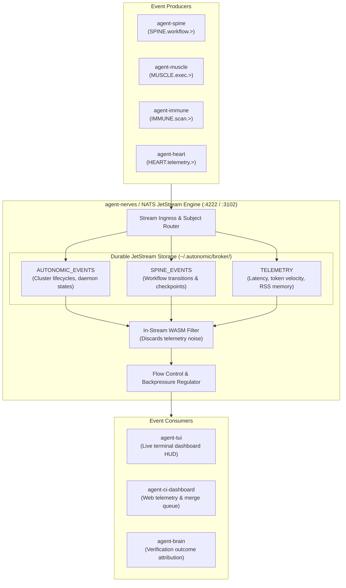

# agent-nerves — Deep Operational & Architectural Context for Agents

> **Distributed Event Mesh, NATS JetStream Bridge & IPC Telemetry Fabric** — In-depth architectural guide, stream persistence, backpressure regulation, CLI matrix, HTTP/MCP contracts, and failure recovery runbooks for `agent-nerves`.  
> **Ecosystem Version Baseline:** `v1.0.0-beta.3`  
> **Documentation Hub:** [https://autonomic-ai.dev/docs/networking](https://autonomic-ai.dev/docs/networking) · [Architecture Hub](https://autonomic-ai.dev/docs/architecture)  
> **Port:** HTTP API `:3102` · NATS Client `:4222` · NATS Monitor `:8222`  
> **Default Workspace & Broker:** `~/.autonomic/nerves/` · `~/.autonomic/broker/`

---

## 1. Executive Summary & Biological Role

In the Autonomic 11-organ architecture, **`agent-nerves`** serves as the **Distributed Neural Fabric, Service Mesh, and High-Throughput Event Bridge** (analogous to Istio Service Mesh, Kubernetes Event Bus, and NATS JetStream infrastructure).

Monolithic AI agent systems bundle cognitive loops, tool executions, and event telemetry in a single process memory space. In production, this breaks down under:
1. **Crash Propagation & State Loss:** An unhandled error in a peripheral tool tears down the entire agent process, losing active context and execution history.
2. **Head-of-Line Blocking & Race Conditions:** Concurrent operations without an asynchronous event broker result in deadlocks between UI polling, tool runs, and LLM streaming.
3. **Absence of Replayability:** Without a durable message stream, there is no way to reconstruct the exact sequence of events that led to a hallucination or runtime error.

`agent-nerves` provides the solution by establishing a sub-millisecond, distributed pub/sub event mesh:
- Bridges all independent Rust organ daemons over **NATS JetStream** (`nats://127.0.0.1:4222`).
- Guarantees **at-least-once message delivery, message deduplication, and ordered replay**.
- Implements active **backpressure and flow regulation**, ensuring fast producers never overwhelm slow LLM inference consumers.

---

## 2. Core Architecture & Stream Topology



### 2.1 The Core JetStream Streams
`agent-nerves` manages persistent JetStream streams backed by local disk storage (`~/.autonomic/broker/`):
- **`AUTONOMIC_EVENTS`**: Tracks organ registration, heartbeat probes, daemon reboots, and supervisor lifecycle signals.
- **`SPINE_EVENTS`**: Emits discrete workflow transitions (`SPINE.workflow.started`, `SPINE.step.completed`, `SPINE.gate.paused`). Allows time-travel debugging and event replay.
- **`TELEMETRY`**: Captures latency metrics, RSS memory usage, and token consumption velocities.

### 2.2 In-Stream WASM Event Filtering
High-frequency telemetry (like per-millisecond process sampling) can easily flood downstream consumers:
- `agent-nerves` embeds a lightweight WebAssembly filter engine (`wasmtime`).
- Subscribed agents define declarative WASM predicates to discard unneeded telemetry events before network serialization, keeping memory footprints minimal.

---

## 3. Complete CLI Command Reference & Flags

`agent-nerves` provides a single native binary for daemon service, stream inspection, event publishing, and latency probes:

### 3.1 Daemon & Event Bridge Service
- `agent-nerves serve`: Start the HTTP REST API bridge and NATS JetStream event engine.
  - `--port <PORT>`: HTTP API listening port (default: `3102`).
  - `--nats-url <URL>`: NATS broker URL (default: `nats://127.0.0.1:4222`).
  - `--cluster-id <ID>`: Namespace cluster ID (default: `autonomic-local`).
  - `--enable-wasm-filters`: Enable in-stream WebAssembly event filtering (default: `true`).

### 3.2 Stream Inspection & Telemetry
- `agent-nerves stream list`: Display active JetStream streams, retained message counts, and consumer groups.
  - `--json`: Output stream metadata in structured JSON.
- `agent-nerves stream tail <STREAM|SUBJECT>`: Stream live messages in the terminal with timestamps and payload decoding.
  - `--limit <N>`: Replay the last N retained messages from stream history before following live.
  - `--follow`: Keep connection open to tail new messages in real time.
- `agent-nerves ping`: Probe local NATS message mesh and measure round-trip latency.

### 3.3 Event Publishing
- `agent-nerves publish`: Publish an event payload onto the message mesh from CLI.
  - `--subject <SUBJECT>`: Target NATS subject (e.g. `AUTONOMIC.telemetry.heartbeat`).
  - `--data "<JSON>"`: Event payload string.

### 3.4 Diagnostics & Health Audit
- `agent-nerves doctor`: Audit NATS server connectivity (`:4222`), JetStream disk storage permissions, and HTTP API responsiveness.

---

## 4. HTTP & Model Context Protocol (MCP) Contracts

### 4.1 HTTP REST Endpoints (`:3102`)

#### `POST /publish`
Publish an event onto the mesh.
Request:
```json
{
  "subject": "AUTONOMIC.task.completed",
  "payload": {
    "task_id": "mission-492",
    "exit_code": 0,
    "duration_ms": 340
  }
}
```
Response (`200 OK`):
```json
{
  "published": true,
  "sequence_id": 14209,
  "stream": "AUTONOMIC_EVENTS"
}
```

#### `GET /health`
Returns mesh connection status, NATS client connection state, and active subscriptions.

---

### 4.2 MCP Tools (via `agent-body serve-mcp` or stdio)

#### `nerves_publish`
- **Description:** Emits an event onto a NATS subject topic on the local cluster mesh.
- **Parameters:**
  - `subject` (string, required): NATS subject string (e.g. `SPINE.step.completed`).
  - `payload` (object, required): Structured JSON payload to emit.

#### `nerves_subscribe`
- **Description:** Subscribes to events matching a subject pattern and receives messages via callback.
- **Parameters:**
  - `subject_pattern` (string, required): Subject wildcard pattern (e.g. `SPINE.workflow.>`).

#### `nerves_stream_tail`
- **Description:** Inspects recent historical messages from a persistent JetStream stream log.
- **Parameters:**
  - `stream_name` (string, required): Target stream (`AUTONOMIC_EVENTS`, `SPINE_EVENTS`, `TELEMETRY`).
  - `limit` (integer, optional, default `10`): Number of recent messages to return.

#### `nerves_ping`
- **Description:** Probes connectivity and measures round-trip latency to the NATS JetStream event mesh.

---

## 5. Troubleshooting & Recovery Runbook

### 5.1 Problem: NATS Broker Connection Refused (`:4222`)
- **Cause:** Underlying `nats-server` process is not running.
- **Resolution:**
  - Check broker status:
    ```bash
    curl -s http://127.0.0.1:8222/healthz
    ```
  - Start or restart broker via `agent-body`:
    ```bash
    autonomic restart
    ```

### 5.2 Problem: JetStream Storage Disk Exhaustion
- **Cause:** Telemetry stream accumulated excessive messages in `~/.autonomic/broker/`.
- **Resolution:**
  - Inspect stream storage sizes:
    ```bash
    agent-nerves stream list
    ```
  - Prune or purge old stream history:
    ```bash
    nats stream purge TELEMETRY -s nats://127.0.0.1:4222
    ```
